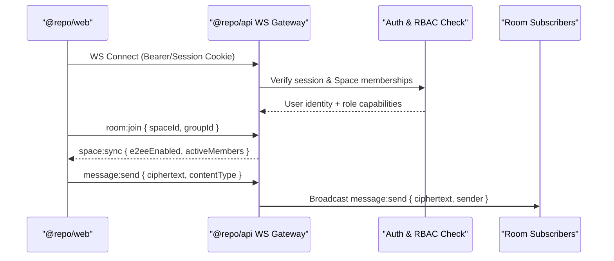

# API & Realtime Protocol Contracts

All shared event names and protocol constants are sourced from [`packages/shared/src/constants.js`](../../packages/shared/src/constants.js) so `@repo/web` and `@repo/api` stay strictly synchronized.

---

## 1. HTTP REST Endpoints (`@repo/api`)

### Available Today (Phase 1 Scaffold + Phase 2 Metadata)

| Method | Path | Handler Source | Description |
| :--- | :--- | :--- | :--- |
| `GET` | `/health` | [`apps/api/src/app.controller.ts`](../../apps/api/src/app.controller.ts) | Service status, `APP_NAME`, `APP_VERSION`, ISO timestamp |
| `GET` | `/api/v1/rooms/meta` | [`apps/api/src/app.controller.ts`](../../apps/api/src/app.controller.ts) | `ROOM_CATEGORIES` and `WS_EVENTS` registry |
| `GET` | `/api/v1/spaces/meta` | [`apps/api/src/modules/spaces/spaces.controller.ts`](../../apps/api/src/modules/spaces/spaces.controller.ts) | `SPACE_GROUP_TYPES`, `RBAC_ROLES`, `RBAC_CAPABILITIES`, `ENCRYPTION_POLICIES` |
| `GET` | `/api/v1/integrations/meta` | [`apps/api/src/app.controller.ts`](../../apps/api/src/app.controller.ts) | `ACTIVITY_SOURCES`, `ACTIVITY_SYNC_DEFAULTS`, `AI_MANAGER_MODULES` |
| `GET` | `/api/v1/compiler/languages` | [`apps/api/src/modules/compiler/compiler.controller.ts`](../../apps/api/src/modules/compiler/compiler.controller.ts) | `SUPPORTED_LANGUAGES` and current `executionMode` |

### Planned Phase 2 Resource Routes

- `/api/v1/auth/*` — Registration, login, session refresh, OAuth callbacks, and public key bundle upload
- `/api/v1/spaces/*` — Space CRUD, group creation (`lounge`, `rooms`, `workspace`, `channels`, `projects`), RBAC role updates, and Owner E2EE toggle
- `/api/v1/messages/*` & `/api/v1/files/*` — Encrypted message pagination, pre-signed attachment upload/download, and DM threads
- `/api/v1/compiler/execute` — Sandboxed code execution endpoint for `python`, `javascript`, `typescript`, `cpp`
- `/api/v1/activity/*` — Activity Synchronisation Engine log map queries & plugin opt-in controls
- `/api/v1/ai/*` — `CollabBot AI` command invocation (`room_manager`, `file_manager`, `schedule_manager`, `office_manager`)

---

## 2. WebSocket Event Registry (`WS_EVENTS`)

Defined in [`packages/shared/src/constants.js`](../../packages/shared/src/constants.js):

| Constant Key | Event Name | Direction | Purpose |
| :--- | :--- | :--- | :--- |
| `ROOM_JOIN` | `room:join` | Client → Server | Subscribe socket to a room/group channel |
| `ROOM_LEAVE` | `room:leave` | Client → Server | Unsubscribe socket from a room/group channel |
| `MESSAGE_SEND` | `message:send` | Bidirectional | Send/broadcast text, media, data-model, or encrypted payloads |
| `CODE_SHARE` | `code:share` | Bidirectional | Push Scratchpad code snippet to active room stream |
| `VOICE_STATE` | `voice:state` | Bidirectional | Sync voice connection, mute, and deafen status |
| `SPACE_SYNC` | `space:sync` | Server → Client | Propagate Space metadata, RBAC, and E2EE policy changes |
| `VOICE_SIGNAL` | `voice:signal` | Bidirectional | WebRTC SDP offer/answer and ICE candidate exchange |
| `SCREEN_SHARE_STATE` | `screen_share:state` | Bidirectional | Start/stop screen share stream indicator |
| `ACTIVITY_SYNC` | `activity:sync` | Server → Client | Real-time WakaTime/GitHub/LeetCode/social sync events |
| `AI_PROMPT` | `ai:prompt` | Bidirectional | Stream `@CollabBot` prompts and structured responses |
| `E2EE_KEY_EXCHANGE` | `e2ee:key_exchange` | Bidirectional | Distribute pre-key bundles and group sender key updates |

---

## 3. Realtime Connection Sequence (Phase 2 Target)

