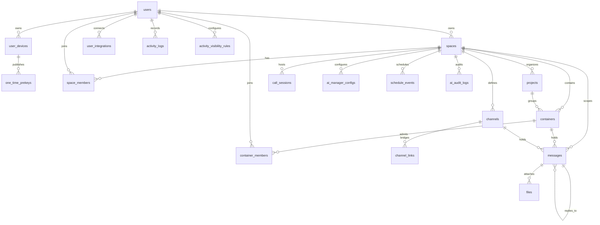

# PostgreSQL 16+ & Drizzle ORM Database Design

> **Target Stack:** PostgreSQL 16+ · Drizzle ORM (`drizzle-orm/pg-core`) · TypeScript (Node.js / Bun)  
> **Source Blueprint:** [`docs/ARCHITECTURE_AND_DB_BLUEPRINT.md`](../ARCHITECTURE_AND_DB_BLUEPRINT.md) · **Master Plan:** [`docs/roadmap/MASTER_IMPLEMENTATION_PLAN.md`](../roadmap/MASTER_IMPLEMENTATION_PLAN.md)

This document specifies the 19 relational tables, modular Drizzle schema structure, entity relationships, and SQL-level data integrity invariants across all five platform domains.

---

## 1. Full Relational ER Diagram (19 Tables)



---

## 2. Modular Schema Organization (`apps/api/src/db/schema/`)

Use native PostgreSQL `uuid` primary keys (`defaultRandom()`), `timestamp(..., { withTimezone: true })` (`timestamptz`), PostgreSQL `pgEnum` types, and `jsonb` for structured payloads.

```text
apps/api/src/db/
├── drizzle.config.ts          # strict: true, verbose: true, dialect: 'postgresql'
├── index.ts                   # Drizzle client + connection pool
├── migrations/                # drizzle-kit migrations + custom invariant SQL
└── schema/
    ├── index.ts               # Re-exports all enums, tables, and Drizzle relations()
    ├── auth.ts                # Domain A: users, user_devices, one_time_prekeys
    ├── spaces.ts              # Domain B: spaces, space_members, projects, containers, container_members, channels, channel_links
    ├── messaging.ts           # Domain C: messages, files, call_sessions
    ├── activity.ts            # Domain D: user_integrations, activity_logs, activity_visibility_rules
    └── ai.ts                  # Domain E: ai_manager_configs, schedule_events, ai_audit_logs
```

---

## 3. Domain-by-Domain Table Specifications

### Domain A: Identity, Devices & Key Registry (`schema/auth.ts`)

| Table | Key Columns & Constraints | Purpose |
| :--- | :--- | :--- |
| `users` | `id` (`uuid` PK), `email` (`varchar(255)` UNIQUE NOT NULL), `username` (`varchar(64)` UNIQUE NOT NULL), `display_name` (`varchar(120)` NOT NULL), `password_hash` (`text` NOT NULL, Argon2id), `avatar_url` (`text`), `created_at`, `updated_at` (`timestamptz`) | Core user accounts and authentication credentials. |
| `user_devices` | `id` (`uuid` PK), `user_id` (`uuid` FK → `users.id` `ON DELETE CASCADE`), `device_name` (`varchar(100)` NOT NULL), `identity_public_key` (`text` NOT NULL), `signed_prekey` (`text` NOT NULL), `signed_prekey_signature` (`text` NOT NULL), `last_active_at` (`timestamptz`), `created_at` (`timestamptz`) | Per-device E2EE identity keys and signed pre-keys. |
| `one_time_prekeys` | `id` (`uuid` PK), `device_id` (`uuid` FK → `user_devices.id` `ON DELETE CASCADE`), `key_id` (`integer` NOT NULL), `public_key` (`text` NOT NULL), `is_consumed` (`boolean` DEFAULT `false` NOT NULL) | Consumable X3DH pre-keys for asynchronous session setup. |

### Domain B: Multi-Tenancy, Building Hierarchy & RBAC (`schema/spaces.ts`)

**PostgreSQL Enums:**
- `space_role`: `'OWNER' | 'ADMIN' | 'MODERATOR' | 'MEMBER'`
- `container_type`: `'LOUNGE' | 'ROOM' | 'WORKSPACE' | 'DM'`
- `channel_link_target`: `'SPACE' | 'PROJECT' | 'WORKSPACE' | 'ROOM'`

| Table | Key Columns & Constraints | Purpose |
| :--- | :--- | :--- |
| `spaces` | `id` (`uuid` PK), `name` (`varchar(120)` NOT NULL), `slug` (`varchar(140)` UNIQUE NOT NULL), `owner_id` (`uuid` FK → `users.id` NOT NULL), `is_e2ee_enabled` (`boolean` DEFAULT `true` NOT NULL), `settings` (`jsonb` DEFAULT `'{}'` NOT NULL), `created_at`, `updated_at` (`timestamptz`) | Top-level tenant floor; defaults to E2EE ON. |
| `space_members` | `space_id` (`uuid` FK → `spaces.id` `ON DELETE CASCADE`), `user_id` (`uuid` FK → `users.id` `ON DELETE CASCADE`), `role` (`space_role` DEFAULT `'MEMBER'` NOT NULL), `joined_at` (`timestamptz`); PK `(space_id, user_id)` | Space membership and RBAC role assignment. |
| `projects` | `id` (`uuid` PK), `space_id` (`uuid` FK → `spaces.id` `ON DELETE CASCADE`), `name` (`varchar(120)` NOT NULL), `description` (`text`), `created_by` (`uuid` FK → `users.id`), `created_at`, `updated_at` (`timestamptz`) | Optional wing classifying nested Rooms and Workspaces. |
| `containers` | `id` (`uuid` PK), `space_id` (`uuid` FK → `spaces.id` `ON DELETE CASCADE`), `project_id` (`uuid` FK → `projects.id` `ON DELETE SET NULL`), `type` (`container_type` NOT NULL), `name` (`varchar(120)`), `is_e2ee_enforced` (`boolean` DEFAULT `true` NOT NULL), `created_by` (`uuid` FK → `users.id`), `created_at`, `updated_at` (`timestamptz`) | Unified table for `LOUNGE` (1:1 per Space), `ROOM`, `WORKSPACE`, and `DM`. |
| `container_members` | `container_id` (`uuid` FK → `containers.id` `ON DELETE CASCADE`), `user_id` (`uuid` FK → `users.id` `ON DELETE CASCADE`), `invited_by` (`uuid` FK → `users.id`), `can_invite` (`boolean` DEFAULT `false` NOT NULL), `joined_at` (`timestamptz`); PK `(container_id, user_id)` | Explicit membership for `ROOM` (`can_invite = false`), `WORKSPACE` (`can_invite = true`), and `DM`. `LOUNGE` inherits `space_members`. |
| `channels` | `id` (`uuid` PK), `space_id` (`uuid` FK → `spaces.id` `ON DELETE CASCADE`), `name` (`varchar(100)` NOT NULL), `frequency_code` (`varchar(50)`), `is_private` (`boolean` DEFAULT `false` NOT NULL), `created_by` (`uuid` FK → `users.id`), `created_at` (`timestamptz`) | Cross-level satellite radio frequencies bridging 2+ nodes. |
| `channel_links` | `id` (`uuid` PK), `channel_id` (`uuid` FK → `channels.id` `ON DELETE CASCADE`), `target_type` (`channel_link_target` NOT NULL), `target_id` (`uuid` NOT NULL); UNIQUE `(channel_id, target_type, target_id)` | Polymorphic bridge linking a Channel to Space, Project, Workspace, or Room nodes. |

### Domain C: Polymorphic Messaging, Files & Calls (`schema/messaging.ts`)

**PostgreSQL Enums:**
- `message_kind`: `'TEXT' | 'MEDIA' | 'DATA_MODEL' | 'SYSTEM' | 'CALL_EVENT'`
- `data_model_subtype`: `'SPREADSHEET' | 'TXT' | 'PPT' | 'MAIL' | 'CODE_SNIPPET'`
- `call_type`: `'VOICE_CHAT' | 'VOICE_CALL' | 'VIDEO_MEET'`

| Table | Key Columns & Constraints | Purpose |
| :--- | :--- | :--- |
| `messages` | `id` (`uuid` PK), `space_id` (`uuid` FK → `spaces.id` `ON DELETE CASCADE`), `container_id` (`uuid` FK → `containers.id` `ON DELETE CASCADE`), `channel_id` (`uuid` FK → `channels.id` `ON DELETE CASCADE`), `sender_id` (`uuid` FK → `users.id` `ON DELETE SET NULL`), `sender_device_id` (`uuid` FK → `user_devices.id`), `kind` (`message_kind` NOT NULL), `data_model_type` (`data_model_subtype`), `is_encrypted` (`boolean` DEFAULT `true` NOT NULL), `ciphertext` (`text`), `encryption_meta` (`jsonb`), `plaintext_body` (`text`), `structured_payload` (`jsonb`), `reply_to_id` (`uuid` FK → `messages.id` `ON DELETE SET NULL`), `created_at`, `edited_at`, `deleted_at` (`timestamptz`) | Stores zero-knowledge ciphertext (when `is_encrypted = true`) or plaintext/structured payloads (when `is_encrypted = false`). |
| `files` | `id` (`uuid` PK), `space_id` (`uuid` FK → `spaces.id` `ON DELETE CASCADE`), `uploader_id` (`uuid` FK → `users.id`), `message_id` (`uuid` FK → `messages.id` `ON DELETE SET NULL`), `storage_bucket` (`varchar(100)` NOT NULL), `storage_key` (`text` NOT NULL), `encrypted_metadata` (`text`), `plain_filename` (`varchar(255)`), `mime_type` (`varchar(127)`), `size_bytes` (`bigint` NOT NULL), `encryption_meta` (`jsonb`), `created_at` (`timestamptz`) | References S3/R2 encrypted object blobs and wrapped file keys (`{ iv, fileKeyWrap }`). |
| `call_sessions` | `id` (`uuid` PK), `space_id` (`uuid` FK → `spaces.id` `ON DELETE CASCADE`), `container_id` (`uuid` FK → `containers.id`), `channel_id` (`uuid` FK → `channels.id`), `type` (`call_type` NOT NULL), `livekit_room_name` (`varchar(150)` UNIQUE NOT NULL), `started_by` (`uuid` FK → `users.id`), `started_at` (`timestamptz` NOT NULL), `ended_at` (`timestamptz`) | Tracks active and historical LiveKit WebRTC voice/video sessions. |

### Domain D: Activity Synchronization Engine (`schema/activity.ts`)

**PostgreSQL Enum:**
- `integration_provider`: `'WAKATIME' | 'GITHUB' | 'GITLAB' | 'IDE_PLUGIN' | 'INSTAGRAM' | 'FACEBOOK' | 'X_TWITTER'`

| Table | Key Columns & Constraints | Purpose |
| :--- | :--- | :--- |
| `user_integrations` | `id` (`uuid` PK), `user_id` (`uuid` FK → `users.id` `ON DELETE CASCADE`), `provider` (`integration_provider` NOT NULL), `external_account_id` (`varchar(255)`), `encrypted_tokens` (`text` NOT NULL), `is_broadcast_enabled` (`boolean` DEFAULT `false` NOT NULL), `sync_cursor` (`text`), `updated_at` (`timestamptz`); UNIQUE `(user_id, provider)` | Stores encrypted OAuth tokens and global broadcast switches per provider. |
| `activity_logs` | `id` (`uuid` PK), `user_id` (`uuid` FK → `users.id` `ON DELETE CASCADE`), `provider` (`integration_provider` NOT NULL), `event_type` (`varchar(100)` NOT NULL), `summary` (`text` NOT NULL), `raw_payload` (`jsonb` NOT NULL), `occurred_at` (`timestamptz` NOT NULL), `indexed_at` (`timestamptz` DEFAULT `now()` NOT NULL) | Personal cross-platform activity log map visible to the owning user by default. |
| `activity_visibility_rules` | `id` (`uuid` PK), `user_id` (`uuid` FK → `users.id` `ON DELETE CASCADE`), `provider` (`integration_provider` NOT NULL), `target_space_id` (`uuid` FK → `spaces.id` `ON DELETE CASCADE`), `target_container_id` (`uuid` FK → `containers.id` `ON DELETE CASCADE`), `is_visible` (`boolean` DEFAULT `false` NOT NULL); UNIQUE `(user_id, provider, target_space_id, target_container_id)` | Opt-in visibility per Space or specific Room/Workspace (`target_container_id = NULL` means Space-wide). |

### Domain E: AI Managers (`schema/ai.ts`)

**PostgreSQL Enum:**
- `ai_manager_type`: `'ROOM_MANAGER' | 'FILE_MANAGER' | 'SCHEDULE_MANAGER' | 'OFFICE_MANAGER'`

| Table | Key Columns & Constraints | Purpose |
| :--- | :--- | :--- |
| `ai_manager_configs` | `id` (`uuid` PK), `space_id` (`uuid` FK → `spaces.id` `ON DELETE CASCADE`), `container_id` (`uuid` FK → `containers.id` `ON DELETE CASCADE`), `manager_type` (`ai_manager_type` NOT NULL), `is_enabled` (`boolean` DEFAULT `true` NOT NULL), `config` (`jsonb` DEFAULT `'{}'` NOT NULL), `updated_at` (`timestamptz`) | Per-Space or per-Container configuration for each AI Manager module. |
| `schedule_events` | `id` (`uuid` PK), `space_id` (`uuid` FK → `spaces.id` `ON DELETE CASCADE`), `container_id` (`uuid` FK → `containers.id` `ON DELETE SET NULL`), `creator_id` (`uuid` FK → `users.id`), `title` (`varchar(200)` NOT NULL), `description` (`text`), `start_time` (`timestamptz` NOT NULL), `end_time` (`timestamptz` NOT NULL), `generated_by_ai` (`boolean` DEFAULT `false` NOT NULL), `metadata` (`jsonb` DEFAULT `'{}'` NOT NULL) | Coding sprints, meetings, and reminders created manually or by Schedule/Office AI. |
| `ai_audit_logs` | `id` (`uuid` PK), `space_id` (`uuid` FK → `spaces.id` `ON DELETE CASCADE`), `manager_type` (`ai_manager_type` NOT NULL), `action_type` (`varchar(100)` NOT NULL), `summary` (`text` NOT NULL), `context_refs` (`jsonb` DEFAULT `'[]'` NOT NULL), `created_at` (`timestamptz` DEFAULT `now()` NOT NULL) | Immutable audit trail of automated AI Manager actions. |

---

## 4. Critical Database-Level Invariants & Custom SQL Migration

After running `drizzle-kit generate`, append the following constraints and performance indexes to the initial SQL migration:

```sql
-- 1. Guarantee exactly 1 LOUNGE container per Space
CREATE UNIQUE INDEX one_lounge_per_space
  ON containers (space_id)
  WHERE type = 'LOUNGE';

-- 2. LOUNGE and DM containers live directly under a Space and cannot attach to a Project
ALTER TABLE containers
  ADD CONSTRAINT chk_container_project_placement
  CHECK (
    (type IN ('LOUNGE', 'DM') AND project_id IS NULL)
    OR (type IN ('ROOM', 'WORKSPACE'))
  );

-- 3. Every message belongs exclusively to either a container OR a channel (XOR)
ALTER TABLE messages
  ADD CONSTRAINT chk_message_target_xor
  CHECK (
    (container_id IS NOT NULL AND channel_id IS NULL)
    OR (container_id IS NULL AND channel_id IS NOT NULL)
  );

-- 4. Enforce zero-knowledge storage invariant: encrypted messages never persist plaintext
ALTER TABLE messages
  ADD CONSTRAINT chk_message_e2ee_zero_knowledge
  CHECK (
    (is_encrypted = true AND ciphertext IS NOT NULL AND plaintext_body IS NULL AND structured_payload IS NULL)
    OR (is_encrypted = false)
  );

-- 5. Fast reverse-chronological message pagination indexes
CREATE INDEX idx_messages_container_created_at
  ON messages (container_id, created_at DESC)
  WHERE container_id IS NOT NULL AND deleted_at IS NULL;

CREATE INDEX idx_messages_channel_created_at
  ON messages (channel_id, created_at DESC)
  WHERE channel_id IS NOT NULL AND deleted_at IS NULL;
```
