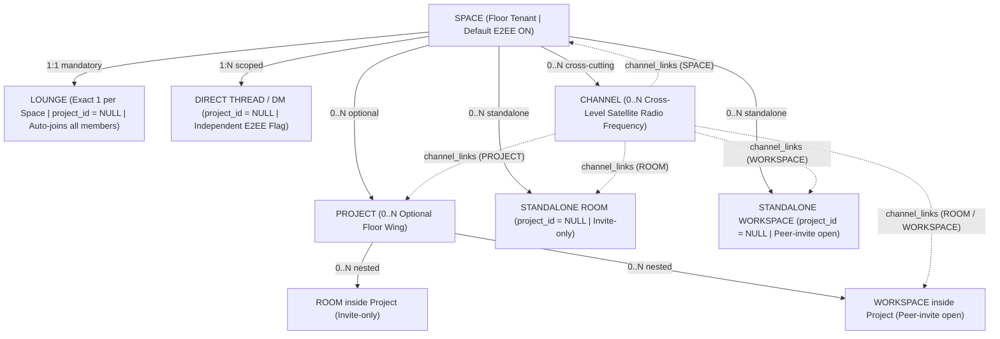
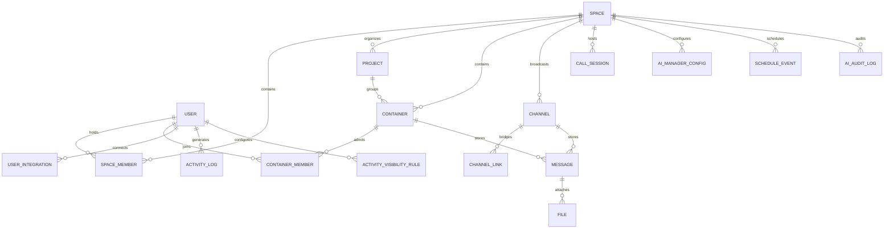

# Domain Model & Multi-Tenancy Specification

This document synthesizes [`docs/VISION.md`](../VISION.md), [`docs/ARCHITECTURE_AND_DB_BLUEPRINT.md`](../ARCHITECTURE_AND_DB_BLUEPRINT.md), and the shared contracts in [`packages/shared/src/domain/`](../../packages/shared/src/domain/index.js).

---

## 1. Conceptual Topology: The Building Metaphor

Collab+ models multi-tenant collaboration as a multi-story building where each **Space** is a self-contained floor. Access boundaries, encryption states, and communication frequencies follow strict spatial rules:

```text
================================================================================
  SPACE (A Floor in the Building)
  - Hard tenant boundary | Default E2EE: ON (Owner-controlled override)
  - Space Roles: OWNER, ADMIN, MODERATOR, MEMBER
================================================================================
  │
  ├──► [1] LOUNGE (Mandatory: Exactly 1 per Space)
  │        └── Open floor lobby / general chat. Auto-joins all Space members.
  │
  ├──► [0..N] PROJECT (Optional Major Classification / Wing)
  │        ├──► [0..N] ROOM (Invite-only, custom-named: Meeting, Presentation)
  │        └──► [0..N] WORKSPACE (Member-invited collaborative studio)
  │
  ├──► [1..N] STANDALONE ROOMS (Directly on the Space floor, project_id = NULL)
  │
  ├──► [1..N] STANDALONE WORKSPACES (Directly on the Space floor, project_id = NULL)
  │
  └──► [0..N] CHANNELS (Cross-Level "Satellite Radio Frequencies")
               ├── Can link: Space-wide (Floor-level broadcast)
               ├── Can link: Project <──> Project
               ├── Can link: Workspace <──> Workspace
               ├── Can link: Room <──> Room
               └── Can link: Room <──> Workspace (Cross-sibling bridge)
```

### Data Hierarchy & Polymorphic Channel Relation Artifact



---

## 2. Entity & Cardinality Rules

| Entity | Metaphor | Cardinality per Space | Access & Invitation Policy | Placement & DB Rule |
| :--- | --- | --- | --- | --- |
| **Space** | The Floor | Root tenant (`1..N` per user) | Protected server boundary. E2EE enabled by default (`is_e2ee_enabled = true`); only `OWNER` can disable it. | Top-level tenant (`spaces`). |
| **Lounge** | Floor Lobby | **Exact 1** (`1:1` with Space) | **No invitation required.** Open to 100% of `space_members` automatically. | Directly under `Space` (`project_id IS NULL`; enforced by partial unique index `one_lounge_per_space`). |
| **Project** | Floor Wing | **0 or more** (Optional) | Major organizational grouping organizing nested Rooms & Workspaces. | Directly under `Space` (`projects`). |
| **Room** | Meeting Room | **1 or more** (Total in Space) | **Strict invite-only & sectioned.** Custom-named (e.g., *Meeting Room*, *Presentation Room*); `can_invite = false`. | Under `Space` (optional `project_id`). |
| **Workspace** | Team Studio | **1 or more** (Total in Space) | **Peer-invite open.** Any current member can invite other Space members (`can_invite = true` by default). | Under `Space` (optional `project_id`). |
| **Channel** | Radio Frequency | **0 or many** | **Cross-cutting frequency.** Bridges 2 or more nodes at the same or different levels. | Under `Space` (`channels`) + polymorphic `channel_links`. |
| **Direct Thread** | Intercom | User-to-User (`1:1` / small group) | **Persistent E2EE.** Independent `is_e2ee_enforced` flag remains `true` even if Space E2EE is disabled. | `containers` (`type = 'DM'`, `project_id IS NULL`). |

---

## 3. Core Database Entity-Relationship Artifact



For complete column-level definitions and SQL constraints across all 19 tables, see [`docs/architecture/DATABASE_DESIGN.md`](./DATABASE_DESIGN.md).

---

## 4. Role-Based Access Control (RBAC)

Defined in [`packages/shared/src/domain/spaces.js`](../../packages/shared/src/domain/spaces.js) (`RBAC_ROLES`, `SPACE_ROLES_ENUM`, `RBAC_CAPABILITIES`):

| Capability | `OWNER` | `ADMIN` | `MODERATOR` | `MEMBER` |
| :--- | :---: | :---: | :---: | :---: |
| `space:delete` | Yes | No | No | No |
| `space:toggle_e2ee` | Yes | No | No | No |
| `space:manage_roles` | Yes | Yes | No | No |
| `space:manage_groups` | Yes | Yes | No | No |
| `space:manage_integrations` | Yes | Yes | No | No |
| `space:moderate_messages` | Yes | Yes | Yes | No |
| `space:share_files` | Yes | Yes | Yes | Yes |
| `space:send_messages` | Yes | Yes | Yes | Yes |
| `space:join_voice` | Yes | Yes | Yes | Yes |

---

## 5. Rich Data-Model Messaging, Calls & File Sharing

Defined in [`packages/shared/src/domain/messaging.js`](../../packages/shared/src/domain/messaging.js):

- **Message Kinds (`MESSAGE_KINDS`)**: `TEXT`, `MEDIA`, `DATA_MODEL`, `SYSTEM`, `CALL_EVENT`
- **Media & File Sharing (`MEDIA_ATTACHMENT_TYPES`)**: `image`, `video`, `gif`, `sticker`, `file` (client-encrypted blobs in S3/R2 referenced by `files`)
- **Data-Model Subtypes (`DATA_MODEL_SUBTYPES`)**: `SPREADSHEET`, `TXT`, `PPT`, `MAIL`, `CODE_SNIPPET`
- **Call Session Types (`CALL_TYPES`)**: `VOICE_CHAT`, `VOICE_CALL`, `VIDEO_MEET` (backed by LiveKit / WebRTC)

---

## 6. Activity Synchronisation Engine & AI Managers

- **Activity Sources (`INTEGRATION_PROVIDERS`)**: `WAKATIME`, `GITHUB`, `GITLAB`, `IDE_PLUGIN`, `INSTAGRAM`, `FACEBOOK`, `X_TWITTER` (plus `leetcode` sync in [`packages/shared/src/domain/activity.js`](../../packages/shared/src/domain/activity.js)).
- **Visibility Defaults (`ACTIVITY_SYNC_DEFAULTS`)**: `activity_logs` are private to the owning user (`userLogMapVisibleToSelf: true`), while Space/Room sharing (`activity_visibility_rules.is_visible`) and notifications default to `false` (opt-in).
- **AI Managers (`AI_MANAGER_TYPES`)**: `ROOM_MANAGER`, `FILE_MANAGER`, `SCHEDULE_MANAGER`, `OFFICE_MANAGER` — configured via `ai_manager_configs`, creating `schedule_events`, and audited via `ai_audit_logs`.
