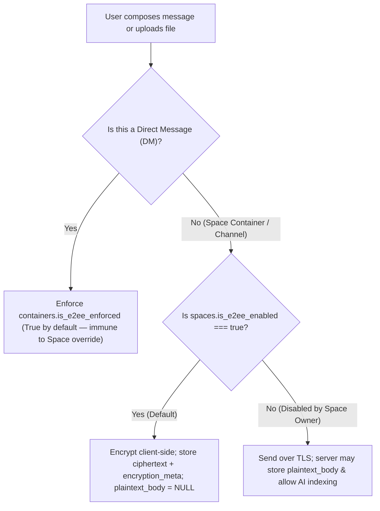

# Security & End-to-End Encryption (E2EE) Architecture

This specification captures the zero-knowledge privacy model defined in [`docs/VISION.md`](../VISION.md), [`docs/ARCHITECTURE_AND_DB_BLUEPRINT.md`](../ARCHITECTURE_AND_DB_BLUEPRINT.md), [`SECURITY.md`](../../SECURITY.md), and [`packages/shared/src/domain/messaging.js`](../../packages/shared/src/domain/messaging.js) (`ENCRYPTION_POLICIES`).

---

## 1. Five Core Security & E2EE Invariants

1. **Default-On Encryption:** Every newly created `Space` initializes with `spaces.is_e2ee_enabled = true` (`ENCRYPTION_POLICIES.enabledByDefault`).
2. **Owner-Only Override:** Only a user holding `space_members.role = 'OWNER'` (`hasSpaceCapability(role, 'space:toggle_e2ee')`) can toggle `spaces.is_e2ee_enabled` to `false`. `ADMIN`, `MODERATOR`, and `MEMBER` roles are rejected.
3. **DM Encryption Immunity:** `containers` with `type = 'DM'` maintain an independent `is_e2ee_enforced` boolean (`true` by default). Even if a Space Owner disables E2EE for the Space, users retain E2EE in their Direct Messages inside that Space.
4. **Zero-Knowledge Storage (PostgreSQL & S3/R2):**
   - When `messages.is_encrypted = true`, PostgreSQL stores **only** `ciphertext`, `sender_device_id`, and `encryption_meta` (`{ iv, keyVersion, algorithm, recipientKeys }`); `plaintext_body` and `structured_payload` remain `NULL` (enforced via SQL `CHECK` constraint).
   - Files are encrypted client-side before upload to S3/R2; PostgreSQL (`files`) stores `encrypted_metadata` and wrapped file keys (`{ iv, fileKeyWrap }`) per recipient/group.
5. **AI Manager Boundary:** AI Managers (`ROOM_MANAGER`, `FILE_MANAGER`, `SCHEDULE_MANAGER`, `OFFICE_MANAGER`) can index plaintext messages/files **only** when Space E2EE is disabled (`is_e2ee_enabled = false`), or when explicitly fed decrypted context or user-permitted `activity_logs`.

---

## 2. E2EE Policy Decision Flow

---

## 3. Multi-Device Key Registry & X3DH Session Setup

Backed by Domain A tables in [`docs/architecture/DATABASE_DESIGN.md`](./DATABASE_DESIGN.md):

- **`users`**: Stores `Argon2id` `password_hash`, `email`, `username`, and `display_name`.
- **`user_devices`**: Registers each client device's `identity_public_key`, `signed_prekey`, and `signed_prekey_signature`.
- **`one_time_prekeys`**: Holds consumable public pre-keys (`key_id`, `public_key`, `is_consumed`) claimed atomically during X3DH / Signal-style session establishment via `WS_EVENTS.E2EE_KEY_EXCHANGE`.
- **Group Key Rotation**: Member removal from `space_members` or `container_members` triggers sender-key rotation so removed devices cannot decrypt future messages.
- **External OAuth & Sandboxing**: Integration OAuth tokens (`user_integrations.encrypted_tokens`) are encrypted at rest; untrusted compiler snippets run in isolated sandboxes with no access to keys, PostgreSQL, or internal networks.
