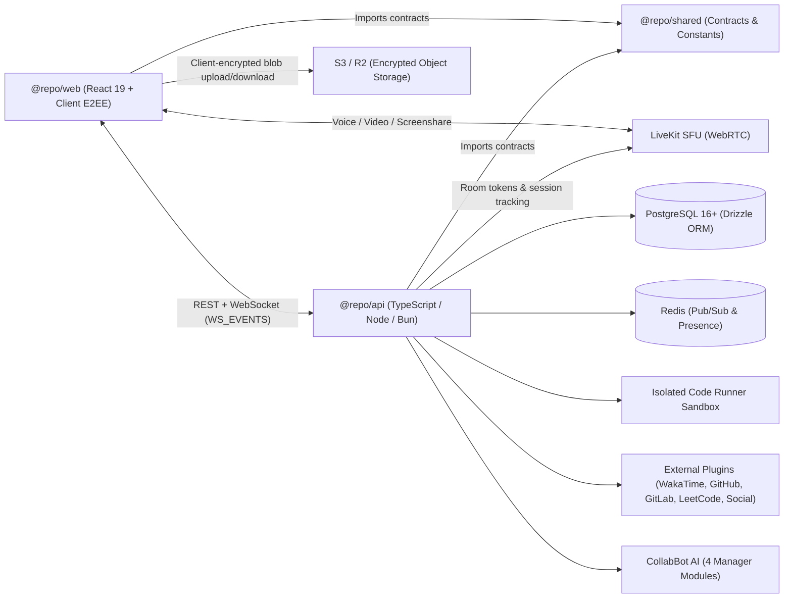

# System Design & Production Tech Stack

> **Canonical Blueprint:** [`docs/ARCHITECTURE_AND_DB_BLUEPRINT.md`](../ARCHITECTURE_AND_DB_BLUEPRINT.md)  
> **Database Spec:** [`docs/architecture/DATABASE_DESIGN.md`](./DATABASE_DESIGN.md) · **Master Plan:** [`docs/roadmap/MASTER_IMPLEMENTATION_PLAN.md`](../roadmap/MASTER_IMPLEMENTATION_PLAN.md)

---

## 1. Target Production Stack

| Layer | Selected Technology | Role in Architecture |
| :--- | :--- | :--- |
| **Frontend Workspace** | React 19 + Vite 8 + Tailwind CSS v4 (`@repo/web`) | 3-split workspace UI, client-side WebCrypto/E2EE key ops, LiveKit WebRTC client |
| **Backend Runtime & API** | TypeScript (Node.js / Bun) (`@repo/api`) | REST `/api/v1/*`, WebSocket event gateway (`WS_EVENTS`), RBAC & transactional services |
| **Shared Contracts** | `@repo/shared` | Single source of truth for enums, RBAC capabilities, E2EE policies, and `WS_EVENTS` |
| **Primary Database** | **PostgreSQL 16+ with Drizzle ORM (`drizzle-orm/pg-core`)** | 19-table relational schema (`uuid` PKs, `timestamptz`, `jsonb`, partial unique & XOR constraints) |
| **Presence & Pub/Sub** | **Redis** | Real-time presence, cross-instance WebSocket fan-out, and ephemeral signaling state |
| **Voice / Video / Screenshare** | **LiveKit (WebRTC)** | SFU-backed `VOICE_CHAT`, `VOICE_CALL`, and `VIDEO_MEET` rooms (`call_sessions`) |
| **Object & File Storage** | **S3 / Cloudflare R2** | Stores client-side encrypted file payloads referenced by `files` metadata rows |
| **Compiler Sandbox** | Isolated ephemeral containers (Docker / Firecracker / Piston) | Network-isolated execution for `python`, `javascript`, `typescript`, and `cpp` |

---

## 2. High-Level System Topology

---

## 3. Spatial Data Hierarchy Summary (Building Metaphor)

Each **Space** represents an isolated building floor containing:
- **1 mandatory `LOUNGE`** (auto-joins all `space_members`, `project_id = NULL`)
- **0..N optional `PROJECTS`** (wings that group nested `ROOM` and `WORKSPACE` containers)
- **1..N `ROOMS`** (strict invite-only, `can_invite = false`) and **1..N `WORKSPACES`** (peer-invite open, `can_invite = true`), either nested under a Project or standalone on the Space floor
- **0..N `CHANNELS`** (cross-level satellite frequencies linked polymorphically via `channel_links` to `SPACE`, `PROJECT`, `WORKSPACE`, or `ROOM` targets)
- **Direct Threads (`DM`)** with persistent independent E2EE enforcement

See [`docs/architecture/DOMAIN_MODEL.md`](./DOMAIN_MODEL.md) and [`docs/architecture/DATABASE_DESIGN.md`](./DATABASE_DESIGN.md) for the complete ER diagram and constraints.

---

## 4. Iterative `Frontend → Backend` Boundary

1. **Contract-First (`@repo/shared`)**: All enums, RBAC capability maps, encryption policy flags, and `WS_EVENTS` live in [`packages/shared/src/`](../../packages/shared/src/index.js).
2. **Backend Domain Modules (`@repo/api/src/modules/`)**: Each domain (`spaces`, `messaging`, `activity`, `ai`, `compiler`) encapsulates business rules and Drizzle persistence services.
3. **Frontend Service Layer (`@repo/web/src/services/`)**: Components consume documented service helpers and fall back cleanly to Phase 1 prototype state until Phase 2 endpoints are wired.
