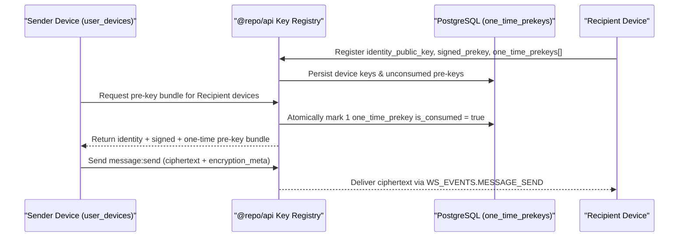
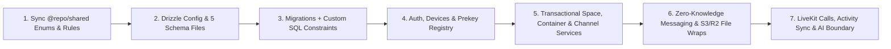

# Master Implementation Plan — Database Design, Encryption & Execution Roadmap

> **Canonical Reference:** [`docs/ARCHITECTURE_AND_DB_BLUEPRINT.md`](../ARCHITECTURE_AND_DB_BLUEPRINT.md)  
> **Companion Specs:** [`Database Design`](../architecture/DATABASE_DESIGN.md) · [`Domain Model`](../architecture/DOMAIN_MODEL.md) · [`Security & E2EE`](../architecture/SECURITY_E2EE.md) · [`Phase 2 Scope`](./PHASE_2_SCOPE.md)

This common plan unifies the **Database Design Plan**, **End-to-End Encryption (E2EE) & Zero-Knowledge Plan**, and **Ordered Service Execution Sequence** required to implement Phase 2 across `@repo/shared`, `@repo/api`, and `@repo/web`.

---

## 1. Database Design & Drizzle ORM Implementation Plan

### 1.1 Target Infrastructure & Tooling
- **Relational Store:** PostgreSQL 16+
- **ORM / Migration Toolkit:** Drizzle ORM (`drizzle-orm/pg-core`) + `drizzle-kit`
- **Type Conventions:** Native PostgreSQL `uuid` primary keys (`defaultRandom()`), `timestamp(..., { withTimezone: true })`, PostgreSQL `pgEnum`, and `jsonb` for structured metadata and encrypted key envelopes.
- **Configuration:** Create `apps/api/drizzle.config.ts` with `strict: true`, `verbose: true`, and `dialect: 'postgresql'`.

### 1.2 Modular Schema Layout (`apps/api/src/db/schema/`)
Split the 19 relational tables into five domain schema files and re-export all tables and Drizzle `relations()` from `src/db/schema/index.ts`:

| Schema File | Domain | Tables |
| :--- | :--- | :--- |
| `src/db/schema/auth.ts` | A: Identity & Keys | `users`, `user_devices`, `one_time_prekeys` |
| `src/db/schema/spaces.ts` | B: Multi-Tenancy & Hierarchy | `spaces`, `space_members`, `projects`, `containers`, `container_members`, `channels`, `channel_links` |
| `src/db/schema/messaging.ts` | C: Messaging, Files & Calls | `messages`, `files`, `call_sessions` |
| `src/db/schema/activity.ts` | D: Activity Sync Engine | `user_integrations`, `activity_logs`, `activity_visibility_rules` |
| `src/db/schema/ai.ts` | E: AI Managers | `ai_manager_configs`, `schedule_events`, `ai_audit_logs` |
| `src/db/schema/index.ts` | Barrel & Relations | Re-exports all enums, tables, and Drizzle `relations()` |

### 1.3 Custom SQL Migration Invariants
Generate baseline migrations via `drizzle-kit generate` and append raw SQL statements for invariants Drizzle schema builders do not express natively:
1. **Exact `1:1` Lounge per Space:** `CREATE UNIQUE INDEX one_lounge_per_space ON containers (space_id) WHERE type = 'LOUNGE';`
2. **Container Placement Rule:** `LOUNGE` and `DM` containers must always have `project_id IS NULL`.
3. **Message Target XOR Rule:** Every row in `messages` must set either `container_id` OR `channel_id`, never both and never neither.
4. **Zero-Knowledge Message Rule:** Whenever `messages.is_encrypted = true`, `ciphertext` must be non-null and `plaintext_body` / `structured_payload` must remain `NULL`.
5. **Chat Pagination Indexes:** Composite partial indexes on `(container_id, created_at DESC)` and `(channel_id, created_at DESC)` where `deleted_at IS NULL`.

### 1.4 Transactional Space Provisioning (`createSpace()`)
Every Space creation runs inside a single PostgreSQL transaction:
1. Insert the `spaces` record with `owner_id` and `is_e2ee_enabled = true`.
2. Insert `(space_id, owner_id, role = 'OWNER')` into `space_members`.
3. Insert the mandatory `LOUNGE` container (`type = 'LOUNGE'`, `project_id = NULL`, `is_e2ee_enforced = true`) into `containers`.

---

## 2. End-to-End Encryption (E2EE) & Zero-Knowledge Plan

### 2.1 Five Non-Negotiable Privacy Rules
1. **Default-On Space E2EE:** Every new `spaces` row initializes with `is_e2ee_enabled = true`.
2. **Owner-Only Override:** Only `space_members.role = 'OWNER'` (`hasSpaceCapability(role, 'space:toggle_e2ee')`) can toggle `spaces.is_e2ee_enabled`. `ADMIN`, `MODERATOR`, and `MEMBER` roles are rejected with `403 Forbidden`.
3. **DM Encryption Immunity:** `containers` with `type = 'DM'` track `is_e2ee_enforced = true` independently of `spaces.is_e2ee_enabled`. Disabling E2EE at the Space level never downgrades Direct Messages inside that Space.
4. **Zero-Knowledge Storage (PostgreSQL & S3/R2):**
   - For encrypted messages, PostgreSQL persists **only** `ciphertext`, `sender_device_id`, and `encryption_meta` (`{ iv, keyVersion, algorithm, recipientKeys }`); `plaintext_body` and `structured_payload` remain `NULL`.
   - Files are encrypted client-side before upload to S3/R2; `files` stores `encrypted_metadata` and `encryption_meta` (`{ iv, fileKeyWrap }`), keeping `plain_filename` `NULL` under E2EE.
5. **AI Manager Boundary:** AI Managers (`ROOM_MANAGER`, `FILE_MANAGER`, `SCHEDULE_MANAGER`, `OFFICE_MANAGER`) may index plaintext messages/files **only** when Space E2EE is disabled (`spaces.is_e2ee_enabled = false`), or when explicitly provided user-consented context/activity payloads.

### 2.2 Multi-Device Key Registry & Session Establishment

### 2.3 Key Rotation & Container Access Enforcement
- **Membership Revocation:** Removing a user from `space_members` or `container_members` triggers a group sender-key rotation event (`WS_EVENTS.E2EE_KEY_EXCHANGE`) so revoked devices cannot decrypt subsequent messages.
- **Room vs. Workspace Invitation Rules:**
  - `LOUNGE`: Auto-inherits `space_members`; keys are distributed to all Space members' active devices.
  - `ROOM`: Strict invite-only (`container_members.can_invite = false` for regular members).
  - `WORKSPACE`: Peer-invite open (`container_members.can_invite = true` by default).

---

## 3. Ordered Execution Plan

1. **Contracts (`@repo/shared`):** Keep TypeScript/JavaScript enums (`CONTAINER_TYPES`, `CHANNEL_LINK_TARGETS`, `MESSAGE_KINDS`, `DATA_MODEL_SUBTYPES`, `CALL_TYPES`, `INTEGRATION_PROVIDERS`, `AI_MANAGER_TYPES`) synchronized with PostgreSQL enums.
2. **Database Layer (`@repo/api/src/db/`):** Scaffold `drizzle.config.ts`, `schema/*.ts`, and custom SQL migrations; add `createSpace()` transactional service.
3. **Auth & Device Key API:** Implement Argon2id authentication, `user_devices` registration, and atomic `one_time_prekeys` claiming.
4. **Spaces, Containers & Channels:** Implement RBAC guards (`OWNER` / `ADMIN` / `MODERATOR` / `MEMBER`), `LOUNGE`/`ROOM`/`WORKSPACE`/`DM` membership enforcement, and polymorphic `channel_links`.
5. **E2EE Messaging & Encrypted Files:** Implement client WebCrypto/libsodium key wrapping in `@repo/web/src/services/`, zero-knowledge validation in `@repo/api/src/modules/messaging/`, and pre-signed S3/R2 ciphertext uploads.
6. **Realtime, Calls, Activity Sync & AI:** Wire Redis Pub/Sub presence, LiveKit room tokens (`call_sessions`), opt-in `activity_visibility_rules`, and AI Manager audit logging (`ai_audit_logs`).
