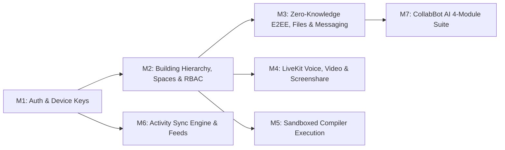

# Phase 2 Scope & Work Breakdown Structure

Phase 2 transitions the project from the Phase 1 interactive UI prototype (`@repo/web`) to an authenticated, end-to-end encrypted, real-time collaborative backend (`@repo/api` + `@repo/shared`) backed by **PostgreSQL 16+ · Drizzle ORM · Redis · LiveKit · S3/R2**. See [`MASTER_IMPLEMENTATION_PLAN.md`](./MASTER_IMPLEMENTATION_PLAN.md) for the consolidated DB and E2EE execution plan.

---

## Milestone Dependency Flow

---

## Milestone 1: Authentication, Sessions & Device Key Registry
- **Workspaces**: `@repo/shared`, `@repo/api` (`src/db/schema/auth.ts`), `@repo/web` (`src/services/`)
- **Deliverables**:
  - Initialize `drizzle.config.ts` targeting PostgreSQL 16+ and modularize `src/db/schema/` (`auth.ts`, `spaces.ts`, `messaging.ts`, `activity.ts`, `ai.ts`)
  - User registration, login, Argon2id password hashing, and session token lifecycle (`users`)
  - Multi-device identity key registration and atomic X3DH pre-key claiming (`user_devices`, `one_time_prekeys`)
  - Login/Session UI shell wired via `@/services`
- **Acceptance Criteria**:
  - Unauthenticated requests to protected `/api/v1/*` routes return `401 Unauthorized`.
  - Authenticated sessions hydrate user profile in `TopBar` and `BottomBar`.

## Milestone 2: Multi-Tenant Spaces, Building Hierarchy & RBAC
- **Workspaces**: `@repo/shared` (`src/domain/spaces.js`), `@repo/api` (`src/db/schema/spaces.ts`, `src/modules/spaces/`), `@repo/web` (`RoomsPanel`, `CreateRoomModal`)
- **Deliverables**:
  - Implement custom SQL constraints (`one_lounge_per_space` partial unique index, `LOUNGE`/`DM` `project_id IS NULL` check)
  - Transactional `createSpace()` service atomically inserting `spaces`, `OWNER` in `space_members`, and the mandatory `1:1` `LOUNGE` container
  - CRUD & membership enforcement for `projects`, invite-only `ROOM` containers (`can_invite = false`), peer-invite `WORKSPACE` containers (`can_invite = true`), and cross-level `channels` + `channel_links`
  - Real-time `WS_EVENTS.SPACE_SYNC` broadcasts via Redis Pub/Sub
- **Acceptance Criteria**:
  - Every Space guarantees exactly 1 `LOUNGE`; `hasSpaceCapability` gates all mutations on both API and UI.

## Milestone 3: Zero-Knowledge E2EE Messaging, Rich Data Models & File Sharing
- **Workspaces**: `@repo/shared` (`src/domain/messaging.js`), `@repo/api` (`src/db/schema/messaging.ts`, `src/modules/messaging/`), `@repo/web` (`ChatPanel`)
- **Deliverables**:
  - Default-on Space E2EE (`spaces.is_e2ee_enabled = true`) with `space:toggle_e2ee` strictly enforced for `OWNER` only
  - Persistent DM E2EE immunity (`containers.is_e2ee_enforced = true` independent of Space toggle)
  - Polymorphic `messages` (`container_id` XOR `channel_id`, zero-knowledge `CHECK` constraint) and encrypted S3/R2 `files` (`{ iv, fileKeyWrap }`)
  - Support for `TEXT`, `MEDIA`, `DATA_MODEL` (`SPREADSHEET`, `TXT`, `PPT`, `MAIL`, `CODE_SNIPPET`), `SYSTEM`, and `CALL_EVENT`
- **Acceptance Criteria**:
  - PostgreSQL stores `plaintext_body = NULL` for all E2EE messages; non-owners receive `403 Forbidden` when attempting to disable Space E2EE.

## Milestone 4: LiveKit Voice Lounges, Video Meets & Screen Sharing
- **Workspaces**: `@repo/shared`, `@repo/api`, `@repo/web` (`TopBar`, `BottomBar`, `RoomsPanel`, `ChatPanel`)
- **Deliverables**:
  - LiveKit room provisioning & token issuance persisted in `call_sessions` (`VOICE_CHAT`, `VOICE_CALL`, `VIDEO_MEET`)
  - WebSocket signaling (`WS_EVENTS.VOICE_SIGNAL`, `VOICE_STATE`, `SCREEN_SHARE_STATE`)
  - Live mute/deafen/participant status synced across `RoomsPanel` and `BottomBar`
- **Acceptance Criteria**:
  - Two browser clients in the same `call_session` exchange live audio, video, and screen-share state updates in real time.

## Milestone 5: Sandboxed Scratchpad Compiler & LeetCode Sync
- **Workspaces**: `@repo/shared`, `@repo/api` (`src/modules/compiler/`), `@repo/web` (`CompilerWorkspacePanel`)
- **Deliverables**:
  - Isolated container/sandbox execution endpoint (`POST /api/v1/compiler/execute`) for `python`, `javascript`, `typescript`, `cpp`
  - Per-execution CPU, memory, and timeout caps with stdout/stderr streaming
  - One-click **Send to Compiler** and **Share to Room** backed by real execution output
- **Acceptance Criteria**:
  - Untrusted code executes without host filesystem/network access and returns real stdout/stderr in `CompilerWorkspacePanel`.

## Milestone 6: Activity Synchronisation Engine & Integrations
- **Workspaces**: `@repo/shared` (`src/domain/activity.js`), `@repo/api` (`src/modules/activity/`), `@repo/web` (`CommandCenterPanel`)
- **Deliverables**:
  - OAuth/webhook ingestion for coding (`wakatime`), project (`github`, `gitlab`, `ide`, `leetcode`), and opt-in social feeds (`instagram`, `facebook`, `x`)
  - Personal Activity Log Map (`userLogMapVisibleToSelf: true` by default; `roomBroadcastOptIn: false`; per-plugin `notificationsOptIn`)
  - Real-time `WS_EVENTS.ACTIVITY_SYNC` feed updates and interactive Space Polls
- **Acceptance Criteria**:
  - Users view their unified activity log map privately by default and can toggle room sharing or social notifications on/off independently.

## Milestone 7: CollabBot AI 4-Module Suite & Mini Social Games
- **Workspaces**: `@repo/shared` (`src/domain/ai.js`), `@repo/api` (`src/modules/ai/`), `@repo/web` (`ChatPanel`, `BottomNavDock`)
- **Deliverables**:
  - Wire `room_manager`, `file_manager`, `schedule_manager`, and `office_manager` handlers via `WS_EVENTS.AI_PROMPT`
  - Interactive coding quizzes, polls, and initial mini social game loop in `games` rooms
- **Acceptance Criteria**:
  - `@CollabBot` and slash commands (`/quiz`, `/files`, `/schedule`, `/notes`) execute against live Space context (respecting E2EE opt-in rules).
